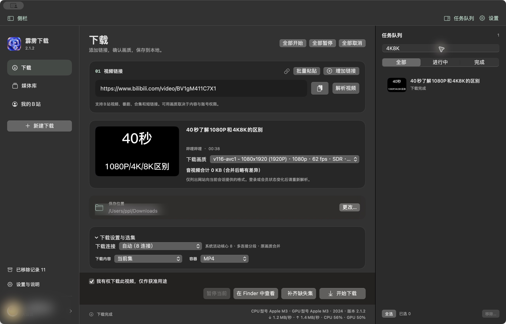
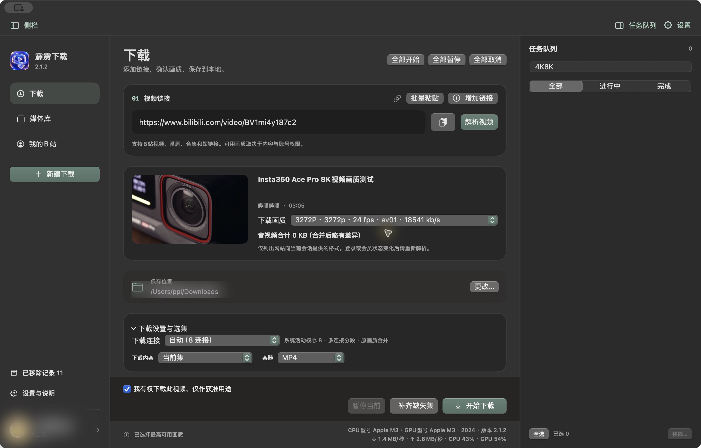
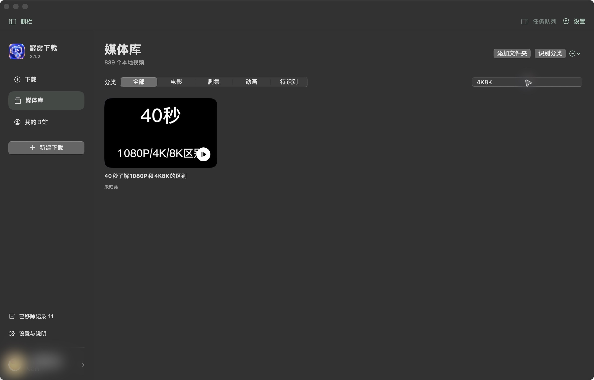

# 霹雳下载 Pili Downloader｜哔哩哔哩 Mac 视频下载器

**作者 / Author：潘飘亮（Pan Piaoliang）**

**Bilibili Mac 下载器 · 多集同时下载 · 整季 / 合集 / 番剧 · 8K/4K 原画 · 专业网盘命名**

> **核心功能先说：多集同时下载。** 支持整季、指定集数范围、多 P 和视频合集；应用根据 Apple Silicon / Intel 的 CPU 型号、活动核心数、实时负载和内存压力动态决定并发数，超出全局预算的任务自动排队。

霹雳下载是一款原生 macOS 本地视频下载与媒体整理工具。它支持单集、指定范围、整季和多集并发下载，在来源与账号实际提供的画质范围内保留原始视频流，并展示比常规画质标签更细的媒体参数：画面尺寸、分辨率、帧率、视频编码、HDR/杜比视界动态范围、视频码率，以及音频编码、采样率、声道、音频码率、容器和文件大小。缺失参数不会猜测或伪造。

Pili Downloader is a native macOS downloader and local media organizer created by **Pan Piaoliang**. It supports single-episode, ranged, full-season, and concurrent multi-episode downloads. Within the quality actually supplied by the source and permitted for the signed-in account, it preserves the original media streams and presents detailed technical information beyond a simple quality label: frame dimensions, resolution, frame rate, video codec, HDR/Dolby Vision dynamic range, video bitrate, audio codec, sample rate, channel count, audio bitrate, container, and file size. Missing source metadata is never guessed or fabricated.

> “与哔哩哔哩一样的画质”是指保留平台实际提供且当前账号有权访问的源画质，不代表提高、解锁或绕过平台限制。
>
> “Same quality as Bilibili” means preserving the source quality actually provided by the platform and available to the current account. It does not upscale, unlock, or bypass platform restrictions.

  

### 核心能力

- **B站内容全覆盖**：支持普通长视频、多 P 视频、合集、番剧、影视 `ss` 整季链接、单集 `ep` 链接、AV/BV 编号和 `b23.tv` 短链接。
- **按 CPU 性能决定多集并发**：可选择当前集、指定集数范围或整季；每集作为独立任务并发执行。应用识别 Apple Silicon/Intel 处理器型号、活动核心数、实时 CPU 负载和内存压力，先推荐合适的同时下载集数，也允许用户手动调整；超出全局安全预算的任务自动排队，不阻塞整个列表。
- **专业网盘式命名**：可组合三位集号、剧情标题、实测分辨率、视频编码、音频规格和真实文件大小，例如 `001 - 剧情标题 - 2160p HEVC - AAC 2.0 - 123.4MB.mp4`。
- **保留可用源画质**：列出当前会话实际获取的格式、分辨率、帧率、编码和码率；高权限内容可直接下载最高可用格式，截图实例为 8K 宽画幅 `3272P / 3272p / 24 fps / AV1 / 18,541 kb/s`。
- **可验证的成品**：下载完成后按实际媒体参数二次校正文件名，并保留日志、来源信息和媒体库记录。

## 软件实际界面 / Real application screenshots

以下均为霹雳下载 2.1.2 的真实运行界面，不是概念图。截图中的网络速度、CPU 占用和硬件信息属于截屏时的实际采样值，会随设备与网络变化；账号昵称与本机用户路径已做平滑模糊处理。

**下载主界面**：面向 macOS 的哔哩哔哩视频下载入口，左侧集中链接解析、画质、保存位置和批量操作，右侧显示可多选的独立任务队列与完成状态。

**8K 原画与批量设置**：实际解析到 8K 宽画幅 `3272P`、24 fps、AV1、18,541 kb/s 格式；同时显示自动连接数、原画质流复制合并、当前集/范围/整季选集、容器和实时硬件状态。

**媒体库**：下载完成后自动进入本地媒体库，可按电影、剧集、动画、待识别分类，通过片名搜索并直接播放。

## 开源内容与目录

本仓库不只提供说明文档，完整 macOS 源码、测试、构建脚本、平台代码和技术资料均纳入版本管理：

| 路径 | 内容 |
|---|---|
| `Sources/` | 47 个 Swift 源文件：下载调度、官方接口、任务恢复、媒体库、分类整理、账号安全和四页原生界面 |
| `Tests/` | 状态、并发、续传、分类、升级兼容、网络与下载夹具等 19 个测试文件 |
| `scripts/` | macOS 通用包、状态回归、签名、依赖构建以及 Windows/Android/iOS 辅助脚本 |
| `Tools/` | 缩略图独立进程源码 |
| `platforms/` | Windows、Android、iOS 平台实现和工程文件 |
| `docs/` | 完整使用教程、开源内容清单与项目说明 |
| `Assets/` | 应用图标和 TMDB 标识资源 |
| `.github/` | CI、Issue 表单与 Pull Request 模板 |
| `LICENSE` | MIT 许可证 |
| `THIRD_PARTY_NOTICES.md` | yt-dlp、FFmpeg、aria2 等第三方组件与许可证说明 |

源码包同时作为 Release 附件提供，便于离线构建与长期归档。仓库会排除 `.build/`、`work/`、用户缓存、账号会话、下载媒体、签名证书和本机路径。

### 三项核心批量下载能力

1. **多个画质与码率可选**：解析后列出来源和当前账号实际可用的多个格式，展示分辨率、帧率、编码、动态范围与码率；用户可选最高画质或兼容方案。
2. **多集同时下载**：番剧、合集和多 P 内容可选择当前集、范围或整季；每集独立并发，某一集暂停或失败不会阻塞整个列表。
3. **按 CPU 性能动态决定并发**：应用根据 Apple Silicon/Intel 处理器型号、活动核心数、实时 CPU 占用和内存压力推荐同时下载集数，并允许手动调整；8GB 设备自动收紧，所有任务最终仍受全局稳定预算保护。

2.1.2重新安排原生工作区：左侧只保留下载/媒体库/我的B站导航，右侧紧凑任务队列支持多选与⌘A；主区突出链接、画质、保存位置和固定操作区。全部开始/暂停/取消集中在标题旁，高级设置和日志默认折叠。媒体库统一分类筛选、搜索与识别入口；收藏自动读取首个文件夹。设置中提供外观、自检以及独立“使用与隐私”说明。保留2.1.1全部下载、安全和低内存策略，最低系统仍macOS13。

2.1.1整合修复：低内存模式（8GB级别最多2集、每集4连接）、图片按需缩小加载、限额网络数据、单路受限子进程缩略图、历史去重队列、固定图标复用及内存压力下安全暂停。媒体库与未归类合并；侧栏可折叠、导航整行可点；下载/已移除记录支持原生多选和⌘A、批量删除只动记录。下载区提供全部开始/全部暂停/全部取消及单任务暂停。收藏封面统一HTTP/协议相对地址到HTTPS。TMDB支持自有读取令牌/API Key申请、导入、验证、Keychain保存和按整季批量识别预览。

作者：潘飘亮。2.0 基于现有 1.8.3 工程继续开发，保留 Bilibili 解析、yt-dlp 回退、ffmpeg 合并与旧名分片续传。下载为第一入口，提供媒体库、未归类、我的B站四页。

新增真实停止下载进程的暂停/继续、持久化传输检查点、全局四集/每集最多八连接、整季完成与分流进度汇总、稳定媒体ID、改名重定位、磁盘/内存图片缓存、本地缩略图、钥匙串会话及主动Chrome导入、只读收藏浏览。

升级保持 `local.pili.downloader` 和原任务目录；首次改写旧历史前保存字节级快照。升级前先退出旧版，再把新版拖入“应用程序”替换原应用。不要同时运行新旧版。旧版 JSON 数组保留兼容，新媒体索引单独持久化；不搬动下载目录或默认更名视频。

分辨率命名以实测尺寸短边为准：3840×2160为2160p，不是3840p。未归类页逐个用mdls和ffmpeg核验并预览纠正，冲突不覆盖。完成后自动检查能精确关联到完整成品的残留，用户确认后移到废纸篓；未知.part保留续传。删除任务记录不删除媒体文件。

凭据新写入系统钥匙串。旧版明文会话可在“我的B站”确认清理；旧TMDB令牌重新保存到钥匙串时清除原偏好副本。Chrome导入只由用户点击触发，仅查询B站域名会话，不绕过系统权限；新加密格式可能需要改用内置登录。收藏接口变化可能导致读取失败，不影响下载入口。

构建：`bash scripts/build.sh`；通用包：`python3 scripts/build-macos-universal.py`；状态回归：`python3 scripts/test-state.py`；共享核心：`swift test`。工具二进制不纳入源代码，放入 `work/deps/` 后再构建；许可随应用打包。

本地签名并非Apple公证；Intel旧机、真实大会员、收藏权限及203集全量网络压力需实机验收，自动化通过不代表所有环境均已验证。详见 ROADMAP.md / CONTRIBUTING.md。

「高级选集、音频与附属文件」提供可关闭的影视规格命名、奇偶/自定义选集、独立音轨选择、限速、重试、字幕/弹幕XML/封面与安全来源元数据。文件名和界面日志不写来源编号；内部编号仅用于续传与历史关联。
HDR10/杜比视界沿用提取器dynamic_range；Hi-Res仅在平台返回30251且编解码为FLAC时标识，实际采样率有数据才显示。参考[yt-dlp提取器](https://github.com/yt-dlp/yt-dlp/blob/2026.10.21/yt_dlp/extractor/bilibili.py)与[下载器开发者说明](https://github.com/itsVicOC/bilibili-downloader/blob/main/docs/USER_GUIDE.md)。

macOS通用版包含Intel（x86_64）与Apple Silicon（arm64），最低macOS 13。Apple Silicon专用包仅含arm64。
这不等于覆盖所有2015年Mac：只能运行macOS 11/12的旧机尚未兼容，不建议为本应用修改系统保护或强行升级系统。
这是独立本地应用，不需要 GPT、订阅 AI、Python、Homebrew 或手动下载指令。

## 安装
先暂停旧版本任务并退出旧应用，再安装和启动新版。新旧版本共用原有账号和历史目录，请勿同时运行两个版本写入历史；未完成分片请保留，重新解析后可继续。
打开「霹雳下载-2.1.2-macOS通用版-b47.dmg」，将「霹雳下载.app」拖入 Applications。
在应用程序目录启动即可。此版本使用临时签名，尚无 Developer ID 签名和 Apple 公证。
若系统提示无法验证开发者，可按 macOS 的「系统设置 → 隐私与安全性 → 仍要打开」流程确认。
不会自动关闭 Gatekeeper 或修改系统安全设置。

## 下载
1. 粘贴哔哩哔哩视频、合集、番剧 ss 整季/ep 单集、AV/BV编号或 b23.tv 短链接，点击「解析视频」。
2. 自动选择当前下载会话可用的最高分辨率；可手动切换画质。
3. 选择保存文件夹，确认你有权下载，再点击「开始下载」。
4. 默认使用 MP4 容器，支持 MKV。合并采用流复制，不降低原始画质。
5. 默认自动打开系统终端，展示时间、进度、速度、剩余时间及合并日志。应用内也会显示。
6. 点击「在 Finder 中查看」找到成品。不需要再向 GPT 发消息。

左侧「新建任务」可随时添加任务，切换列表可查看各任务进度；各任务可同时下载，并打开各自终端。也支持 ⌘N 新建窗口。
关闭终端或 Ctrl-C 仅结束监看；暂停/取消请使用应用内按钮。退出时应用会停止下载并保存恢复状态；下次可手动继续，也可在设置中选择重开后恢复。
关闭窗口后应用仍保留任务；可新建窗口，从左侧列表找回运行任务。

## 1.1 下载优化
原生 arm64 aria2c 1.37.0 执行 HTTP 多连接分段传输，AppleTLS 使用系统证书验证。
自动连接数使用系统活动核心数，限2–8连接；手动最多8连接。跨所有任务全局最多4集活动传输，排队任务不占用下载连接。
CPU 核心数不等同于网络带宽，不会为下载占满所有 CPU，也不会解除网站带宽、权限或付费限制。
右下角显示实时网络与可用的CPU/GPU占用。硬件面板可选择显示主屏参数和系统能够读取的频率；未能实测的指标不应作为官方硬件规格。
当服务器不接受多连接或出现 403/429 时，应取消后改为单连接，必要时稍后重试。不会反复无限重试。
下载前显示音视频合计大小；缺少准确大小时按服务器估算/码率估算，信息不足则明确显示未知。
下载中显示当前流已下载／总量；音频和视频单独计量，不能当作整个合集总量。
刚解析的单视频信息最多在内存保留 5 分钟，可避免点击下载后重复解析。启动任务时写入 0700 目录中的 0600 临时元数据文件，结束即删除；内含临时媒体链接，不记录到日志或上传。
2.0可使用应用内官方页面登录，也可由用户主动从Chrome导入B站会话；不执行浏览器页面脚本。
关闭终端只关闭日志监看，下载由 App 内的任务中心持有。
本地自制 16 MiB 测试中，单连接 9.899 秒、8 连接 1.231 秒；两次均验证哈希一致，退出监看后传输继续。这是人为限制单连接带宽的本地测试，不代表 B 站实测提速。
参考源码（仅学习设计，未复制）：
https://github.com/itsVicOC/bilibili-downloader/blob/main/bilibili_downloader/core/downloader.py
https://github.com/itsVicOC/bilibili-downloader/blob/main/bilibili_downloader/core/task_repository.py
下载器衔接遵循 yt-dlp 官方外部下载器实现：
https://github.com/yt-dlp/yt-dlp/blob/2026.10.21/yt_dlp/downloader/external.py

选择「整季」下载该链接提供的正片列表，按编号和标题保存在合集子文件夹；「指定范围」明确设置开始集和结束集。
分 P 批量下载使用所选分辨率作为上限，各分 P 自动选择其权限范围内可用格式。
默认仅下载当前分 P 或所选一集。不支持任意空间列表或直播；不解除访问限制。

## 1.2 番剧与外观
旧版地址校验只接受 /video/，1.2 修复为同时接受 /bangumi/play/ss数字、/bangumi/play/ep数字、/bangumi/media/md数字，以及 /cheese/play/ss数字 或 ep数字。
电影、番剧、纪录片、综艺通常共用影视播放入口，不按内容题材拒绝。课程入口需要该账号已购/获授权，不能保证任意页面或内容都可下载。
ss/ep 番剧链接读取官方正片目录，按集号升序执行，排除其他分区预告；界面显示当前集封面、集号与标题。可选当前集、指定范围、整季。
其他提取器支持的入口按其列表序号执行；没有可靠正片目录时不臆造集号。
使用官方播放信息，不使用地区代理、DRM解密或付费绕过；明确禁用geo bypass。Chrome会话只在本机由用户主动导入，不上传或导出到外部。
普通或已登录账号可用格式由网站决定。仅提供试看、地区限制、会员权限或 DRM 限制时会失败并显示原因，不能保证任意番剧可下载。
实测 ss1376 在未登录状态可解析第一集标题、时长及 9 个格式；这只是元数据验证，不等于203集都能下载，也未代替用户的真实账号整季验收。

左侧「颜色与透明度」提供预设配色、苹果原生色轮/光谱/RGB色板、屏幕取色器、自定义色相、跟随系统/浅色/深色、毛玻璃及55–100%整体不透明度。
外观保存在本机；有「恢复默认外观」。整体透明会同时淡化文字，想保留文字清晰可保持100%并开启毛玻璃。
新版 Finder/安装图标为海蓝色；运行时 Dock 图标随主题变化，不修改已签名的 App 包。
单独音视频流分别计量，因此当前流进度可能重新从 0% 开始，100% 后还可能需要合并。
已有文件不覆盖，未完成的 .part 可续传；更换格式可能产生新的分流文件。
部分编码的 MP4 可能需要兼容的播放器；若容器兼容性有问题，可以改选 MKV。

## 账号与记忆
点击「登录账号」，在应用官方页面登录并授权；或在“我的B站”主动选择Chrome用户并导入B站会话。
应用网页使用非持久化会话，会话凭据由系统钥匙串跨启动保存；不保存账号密码。升级会导入旧版有效会话，原明文副本需在安全设置中确认清理。
每个任务使用 0700 临时目录里的 0600 Cookie 文件供本地后端读取，结束或取消即删除。
应用内退出登录会清除其会话。强制退出或崩溃后，1.7 启动时只回收父进程已退出的旧元数据探测，正常下载与活动任务不受影响。
账号接口明确返回有效会员状态后才显示大会员标识；会员身份不等同于任意视频的下载授权。
登录风控、网站变更、网络限制、账号权限、平台规则都可能导致解析或下载失败，错误会显示在日志里。

## 任务恢复、多链接与来源记录
任务列表保存在本机应用支持目录的 tasks.json，包含公开来源、范围、保存目录、当前集与已完成记录；权限为0600。强制中断后显示「已中断，可继续」，点击继续会刷新授权与临时播放地址。
已确认存在的成品会跳过；未完成分片由 yt-dlp/aria2 尽可能续传。服务端不支持断点、格式改变或残片已删除时可能重新传输，不能保证任何中断都从同一字节继续。
「增加链接」在一个组合任务内增加输入行，支持1–4条链接同时执行；各链接内按集序依次下载。不同链接进度可展开查看。取消会停止该组全部子任务。
保存目录及实际成品子目录持续写入「下载日志.txt」，只写可读片名、文件名与结果；不会记录会话凭证和媒体签名地址。
运行日志固定显示在应用内，不再打开或控制系统终端。
界面采用系统毛玻璃和轻量动画兼容macOS13；不宣称原生新版液态玻璃API或500Hz刷新率。

日志只记录经过隐藏链接和敏感词处理的运行信息，保存在：
~/Library/Application Support/PiliDownloader/Logs/
日志可能包含视频标题、保存路径和观看偏好，请勿随意分享；不自动上传。

## 为什么选择霹雳下载

霹雳下载不是把命令行简单包一层按钮，而是围绕 macOS 用户下载哔哩哔哩视频、番剧和合集的完整工作流设计：从链接解析、剧集选择、画质比较、音轨选择、批量排队，到暂停恢复、成品核验、本地媒体库、重命名和识别，都在同一个原生应用中完成。

### 1. 一个链接下载整季番剧

粘贴哔哩哔哩番剧 `ss` 链接或任意 `ep` 链接后，应用读取官方正片目录并按集号排序。用户可选择当前集、指定集数范围或整季。预告、花絮等其他分区不会被当成正片集数混入任务。已有完整成品会自动跳过，因此同一整季链接还可用于补齐缺集。

### 2. 多集真正并发，不必逐集等待

选择多集或整季后，每集建立独立传输单元。多集可同时下载，超出全局资源预算的任务自动排队。某一集失败、暂停或完成时不会阻塞全部列表，用户可对单集操作，也可统一开始、暂停或取消。

### 3. 与来源一致的可用画质

应用不会把低清视频伪装成高清，也不会通过转码制造虚假“提升”。它在平台来源和当前账号权限实际返回的格式中选择视频与音频，并在合并时采用流复制。也就是说，成品保留来源可用的视频流质量，不主动做有损二次编码。

### 4. 比“1080P/4K”更明细的参数

格式列表和媒体检查可呈现以下信息；只有来源或成品确实包含数据时才显示：

| 类别 | 参数 | 示例与说明 |
|---|---|---|
| 画面 | 实际尺寸 | 例如 `3840 × 2160`，横屏与竖屏均按短边生成 p 标签 |
| 画面 | 分辨率 | 2160p、1080p、720p 等；不会把 3840×2160 错写为 3840p |
| 画面 | 帧率 | 24/25/30/50/60 fps，以来源返回值为准 |
| 视频 | 编码 | H.264/AVC、HEVC/H.265、AV1、VP9 或来源实际编码 |
| 视频 | 动态范围 | SDR、HDR10、Dolby Vision/杜比视界或来源标识 |
| 视频 | 总码率 | 以 kb/s 显示来源提供的 `tbr`；无数据时不臆测 |
| 音频 | 编码 | AAC、FLAC、Opus、AC-3、E-AC-3 等 |
| 音频 | 采样率 | 例如 44.1 kHz、48 kHz；无数据时不显示 |
| 音频 | 声道 | 2.0、5.1 等，以实际声道信息为准 |
| 音频 | 码率 | 以 kb/s 显示来源或成品可验证的音频码率 |
| 文件 | 容器 | MP4 或 MKV，容器不等同于视频编码 |
| 文件 | 大小 | 优先使用服务器精确值，其次按码率与时长估算，并明确区分 |

### 5. 面向真实使用的任务恢复

下载任务、范围、保存目录、当前集和已完成记录保存在本机。暂停会停止实际子进程并写入检查点；异常退出后任务标记为“已中断，可继续”。继续时重新取得临时播放地址，并在服务器与现有分片允许时续传。成品存在且通过检查时直接跳过。

### 6. 针对 8GB Mac 的资源保护

低内存模式会限制同时活动的集数和单集连接数；图片按需缩小加载，内存与磁盘缓存有明确上限，缩略图通过单路受限子进程生成。系统出现内存压力时，应用优先安全暂停而不是继续扩张内存占用。

### 7. 原生 macOS 体验

界面使用 SwiftUI 与 AppKit，支持 Apple Silicon 和 Intel。左侧导航聚焦下载、媒体库和“我的 B 站”，右侧任务队列可折叠；高级设置和日志默认收起，常用操作保持可见。应用不要求用户安装 Python、Homebrew，也不要求复制命令到终端。

## 支持的哔哩哔哩输入类型

- 普通视频网页链接；
- `BV` 编号；
- `AV` 编号；
- `b23.tv` 短链接；
- 多 P 视频；
- 视频合集与播放列表；
- 番剧、电影、纪录片、综艺等影视入口的 `ss` 链接；
- 番剧单集 `ep` 链接；
- 当前提取器能够可靠识别的其他公开视频入口。

不支持直播下载、任意空间列表抓取、DRM 解密、地区代理绕过或会员付费绕过。课程等内容必须由当前账号合法购买或获授权，并仍受平台接口支持情况影响。

## 从粘贴链接到本地成品

1. **识别链接**：规范化普通链接、短链接和 AV/BV 编号。
2. **读取目录**：单视频读取格式；合集/番剧读取可靠的条目目录。
3. **选择范围**：当前集、指定范围、整季或多选条目。
4. **比较格式**：查看分辨率、帧率、编码、动态范围和码率。
5. **选择音轨**：在来源提供时选择普通、杜比或 Hi-Res/无损音轨。
6. **安排任务**：多集与多个链接进入统一队列，按全局资源预算并发。
7. **分段传输**：aria2c 使用系统证书验证进行多连接下载。
8. **音视频合并**：FFmpeg 在本地以流复制方式封装成 MP4 或 MKV。
9. **成品核验**：检查容器、时长、视频轨和音频轨，空文件不会标记完成。
10. **规格校正**：可按成品实际分辨率、编码、音轨和大小校正文件名。
11. **进入媒体库**：建立稳定索引、缩略图和来源记录，便于后续查找与整理。

## 番剧整季下载实例

假设需要保存一部 24 集番剧：

1. 在浏览器打开该番剧任意正片页，复制 `ss` 或 `ep` 地址。
2. 在霹雳下载的“下载”页粘贴并解析。
3. 确认页面显示的是官方正片目录和正确标题。
4. 选择“整季”，或先用“指定范围”下载 1–3 集测试。
5. 选择账号当前可用的目标画质、音轨和 MP4/MKV。
6. 选择空间充足的保存目录后开始。
7. 前几集同时活动，其余排队；可在右侧逐集查看状态。
8. 下载完成后从 Finder 打开合集文件夹，并在“下载日志.txt”核对来源与结果。
9. 将来重新提交相同整季任务时，已有完整成品跳过，仅补齐缺集。

### 固定测试案例：哔哩哔哩番剧 ss39431

测试链接：`https://www.bilibili.com/bangumi/play/ss39431`

该链接用于公开演示以下完整流程：

1. 解析 `ss39431` 的官方正片目录；
2. 展示当前账号实际可用的多个画质/码率方案；
3. 选择当前集、指定范围或整季；
4. 建立多集任务，允许多集同时下载并自动排队；
5. 显示分辨率、帧率、视频编码、动态范围、视频码率及音频规格；
6. 下载完成后再次提交相同整季任务；
7. 应用核对保存目录中的完整成品，已下载集自动跳过；
8. 仅把缺失集加入传输队列，实现整季补齐。

“自动跳过”以完整成品核验为前提。未知或未完成的 `.part` 分片不会冒充成品；若格式、文件名或保存位置发生变化，应用会重新判断，避免错误跳过。

## 多链接批量下载实例

需要同时处理不同合集时，点击“增加链接”，最多加入四条地址。每条链接保持独立的标题、集数和分流进度，组合任务统一暂停或取消。若需要完全独立的控制，也可以创建多个普通任务或用 `⌘N` 新建窗口。

## 文件命名与媒体整理

网盘式命名可组合三位集号、剧情标题、实际分辨率、视频编码、音频规格和成品大小，例如：

`001 - 第一集标题 - 1080p HEVC - AAC 2.0 192kbps - 842MB.mp4`

文件名会清理路径非法字符并限制长度；同名文件不会被静默覆盖。完成后的规格校正读取实际媒体信息，而不是只信任下载前标签。整理、批量改名或移入废纸篓前先生成预览，未知 `.part` 分片会保留给恢复流程。

## 本地媒体库

媒体库用于管理下载完成的视频，而不只是展示下载历史：

- 按电影、剧集、待识别等分类筛选；
- 按标题搜索并在 Finder 中定位；
- 使用稳定媒体 ID，文件移动后可重新关联；
- 按需生成缩略图，避免一次性加载全部大图；
- 使用用户自己的 TMDB 凭据进行候选搜索；
- 按季批量识别并先预览匹配结果；
- 缓存封面与元数据，同时限制内存和磁盘占用。

TMDB 只用于可选的媒体识别和海报信息，不是下载哔哩哔哩视频的必要条件。

## 隐私与安全设计

- 账号密码不由应用保存；
- 会话和 TMDB 凭据写入 macOS 钥匙串；
- Chrome 会话导入必须由用户主动点击，只查询 B 站域名数据；
- 后端临时 Cookie 文件位于权限为 `0700` 的目录，文件权限为 `0600`；
- 临时播放地址和签名地址不写入普通日志；
- 任务结束或取消后删除对应临时凭据文件；
- 日志不自动上传；
- 下载、整理、删除和重命名均在本机执行；
- 删除任务记录不等于删除媒体文件。

## 常见问题与故障排查

### 为什么网页能播放，应用却解析失败？

先确认应用中的登录状态与浏览器一致，然后重新解析。平台风控、接口变更、网络代理、短链接失效或账号权限变化都可能造成差异。查看应用内日志的最后一条明确错误，不要公开包含个人标题或路径的完整日志。

### 为什么列表里没有 4K、HDR 或高帧率？

这些格式必须由平台对当前视频和当前账号实际返回。先登录拥有相应权限的账号并重新解析。霹雳下载不会伪造不存在的格式，也不会把普通视频升频或插帧。

### “最高画质”和“最佳兼容”有什么区别？

最高画质优先来源可用的最高规格；最佳兼容优先更普遍支持的编码。旧播放器不支持 HEVC、AV1 或某些 MP4 组合时，可选择最佳兼容或 MKV 容器。

### 码率是不是越高越清晰？

码率只是参考，还会受到编码效率、画面复杂度、帧率和来源制作质量影响。应用展示来源数据，不把单一数字包装成绝对画质结论。

### 为什么估算大小和最终文件不完全一致？

服务器给出精确大小时直接使用；只有码率和时长时才估算。容器开销、可变码率和来源元数据误差会造成差异，最终以成品文件大小为准。

### 暂停后一定能从原字节继续吗？

应用会保存检查点和已有分片，但服务器是否接受 Range、临时地址是否变化、用户是否改过格式都会影响续传。无法安全续传时可能重新开始当前流。

### 可以同时下载多少集？

界面可建立大量排队任务，但实际活动传输受全局预算、内存和当前硬件状态限制。默认策略更重视整机稳定，不建议把“排队数量”误解为“同时占满网络的数量”。

### 删除任务会不会删除视频？

不会。任务记录和媒体文件分离。涉及移动、改名或移入废纸篓的整理功能会单独显示预览并再次确认。

### 是否必须登录？

公开视频通常可在未登录状态解析；高画质、会员或账号限定内容取决于平台授权。登录不能让用户获得原本没有的权限。

### 是否支持 Windows、Android 或 iPhone？

本仓库发布的 2.1.2 正式版是专门面向 macOS 的通用版本，最低 macOS 13，同时支持 Apple Silicon 和 Intel。

## English overview

**Pili Downloader 2.1.2 is a native macOS application dedicated to downloading authorized Bilibili videos, bangumi episodes, multi-part videos, and playlists. It is created and maintained by Pan Piaoliang.**

Key capabilities:

- Download one episode, a selected range, or a complete season from supported Bilibili `ss`/`ep` pages.
- Run multiple episode transfers concurrently while keeping excess work safely queued.
- Combine up to four links in one grouped task with per-link progress.
- Preserve the source streams available to the current account; merging uses stream copy instead of intentional re-encoding.
- Inspect detailed media information including dimensions, resolution, frame rate, video codec, dynamic range, video bitrate, audio codec, sample rate, channels, audio bitrate, container, and file size.
- Pause real download processes, persist checkpoints, resume interrupted tasks when the server and fragments permit, and skip verified completed files.
- Organize downloaded files in a searchable local media library with thumbnails, relocation, optional TMDB matching, and safe rename previews.
- Protect credentials with macOS Keychain and use restricted temporary files for local downloader processes.
- Run without Python, Homebrew, an AI subscription, or manual command-line setup.
- Use one universal installer on Apple Silicon and Intel Macs running macOS 13 or later.

Quality claims are intentionally precise: “same quality as Bilibili” means the app preserves the source quality actually supplied by Bilibili and authorized for the current account. It does not upscale media, unlock paid formats, decrypt DRM, bypass regional controls, or fabricate missing technical metadata.

## 技术与开源
UI：SwiftUI / AppKit。专用登录：WebKit。下载：独立 Process 后端，无 shell 拼接下载参数。
yt-dlp：2026.10.21 官方通用 macOS 可执行文件，SHA-256 与官方清单核对。
https://github.com/yt-dlp/yt-dlp/releases/tag/2026.10.21
其 Unlicense 和所捆绑组件许可见应用 Contents/Resources/Licenses/。
https://github.com/yt-dlp/yt-dlp/blob/2026.10.21/THIRD_PARTY_LICENSES.txt
FFmpeg：8.0，原生 arm64，本地从未修改的官方源码构建，仅启用文件协议、常见容器封装/解封装；禁用网络和外部库。
许可 LGPL 2.1+；随源码包提供完整对应源码 tar.xz、许可证与构建命令。
https://ffmpeg.org/releases/ffmpeg-8.0.tar.xz
Swift 应用通过独立进程调用这两个工具，没有将它们链接进 UI。
aria2c 为未修改源码构建的独立进程，GPL-2.0+；许可证在 Licenses/aria2-COPYING.txt，完整对应源码及构建命令在新版源码包 ThirdParty/。
不得使用此工具绕过 DRM、会员付费或访问控制。仅处理你有权下载的内容。

## 从源码构建
项目为可直接编译的 SwiftUI 源码，不依赖完整 Xcode，只需 Apple Command Line Tools。
源码包内含已构建的工具，运行：
`bash scripts/build.sh`
验证：`bash scripts/verify.sh`
生成安装镜像：`bash scripts/package.sh`（目标镜像必须尚不存在）。
依赖重建命令和 FFmpeg 完整源码见 ThirdParty/。
